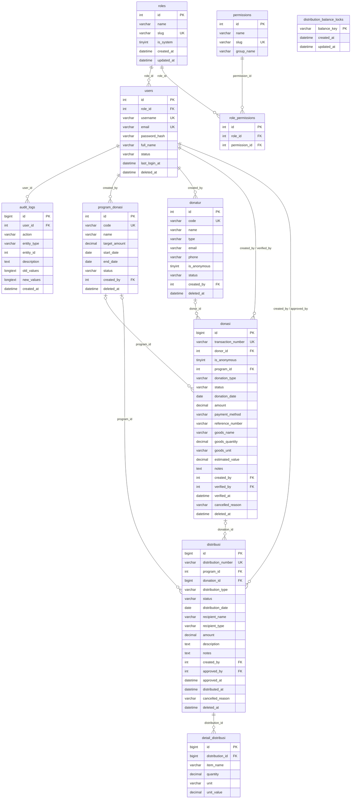

# Sistem Informasi Pengelolaan Donasi Yayasan

Aplikasi pengelolaan donasi berbasis **PHP 8.2 + CodeIgniter 4.7 + MySQL/MariaDB + Bootstrap 5**.

Status saat ini: **Seluruh Prompt 1 sampai Prompt 8 telah SELESAI dan TERVERIFIKASI**.
Aplikasi mencakup autentikasi & RBAC (Admin, Keuangan, Distribusi, Pimpinan), skema database finansial, manajemen donatur, pencatatan donasi (uang & barang) dengan bukti penerimaan cetak, manajemen distribusi donasi dengan bukti penyaluran dan aturan saldo/kunci transaksi, dashboard visual Chart.js dengan 6 KPI riil, serta modul laporan lengkap (penerimaan, distribusi, rekapitulasi, cetak A4 siap PDF, dan ekspor Excel). Seluruh 199 pengujian otomatis PHPUnit lulus 100%.

Detail status dan hasil pengujian ada di [`PROJECT_STATUS.md`](PROJECT_STATUS.md). Panduan kerja untuk pengembang/agen ada di [`AGENTS.md`](AGENTS.md).


## Fitur Tahap 1

- Login username/email, logout, pembatasan percobaan login.
- RBAC berbasis role + permission.
- Dashboard ringkasan.
- CRUD pengguna dengan soft delete, pencarian, filter, dan pagination.
- CRUD role beserta pemilihan permission (transaksi database).
- Audit log append-only dengan filter dan detail.
- Profil dan perubahan password.
- CSRF global, validasi server, escaping output, password hashing.

## Fitur Tahap 3a — Data Donatur

- Daftar donatur dengan pencarian (nama, kode, email, telepon), filter jenis/status, dan pagination.
- Tambah dan ubah donatur dengan validasi server serta konfirmasi CSRF.
- Pencegahan duplikasi: email tidak boleh sama dengan donatur lain yang belum diarsipkan (tanpa membedakan huruf besar/kecil), dan kombinasi nama + nomor telepon juga diperiksa.
- Kode donatur otomatis `DNR-YYYYMMDD-NNNN`, unik termasuk terhadap data yang sudah diarsipkan.
- Detail donatur: kontak, alamat, catatan, metadata, ringkasan donasi, dan riwayat donasi (read-only).
- Aktif/nonaktif dan arsip donatur (soft delete).
- RBAC: `donors.view` untuk melihat, `donors.manage` untuk mengelola.
- Audit log: `donor.created`, `donor.updated`, `donor.activated`, `donor.deactivated`, `donor.archived`.

## Fitur Tahap 3b — Pencatatan dan Bukti Penerimaan Donasi

- Daftar donasi dengan pencarian (nomor transaksi, donatur, catatan), filter jenis/status/tanggal, dan pagination.
- Ringkasan penerimaan mengikuti filter: transaksi aktif, transaksi dibatalkan, nilai uang aktif, dan nilai uang terverifikasi. Transaksi `cancelled` tidak dihitung sebagai penerimaan aktif.
- Tambah dan ubah donasi uang atau barang dengan validasi server dan konfirmasi CSRF.
- Nomor transaksi otomatis `DON-YYYYMMDD-NNNN`, unik dan retry saat terjadi tabrakan.
- Donasi uang: nominal > 0, metode pembayaran, dan nomor referensi wajib untuk transfer bank.
- Donasi barang: nama barang, kuantitas > 0, satuan, dan nilai estimasi opsional.
- Donasi non-anonim wajib memiliki donatur; donasi anonim boleh tanpa donatur dan identitasnya tidak ditampilkan.
- Alur status: `pending` → `verified` → `cancelled`. Hanya donasi `pending` yang dapat diubah.
- Verifikasi mengisi `verified_by` dan `verified_at`.
- Pembatalan wajib beralasan 5–255 karakter dan tidak menghapus data.
- Bukti penerimaan cetak di `/donasi/{id}/receipt`: transaksi `pending` ditandai belum terverifikasi, transaksi `cancelled` ditandai tidak berlaku, dan identitas donatur anonim tidak ditampilkan.
- Operasi tulis finansial memakai transaksi database.
- RBAC: `donations.view` untuk melihat (termasuk bukti penerimaan), `donations.manage` untuk mencatat/mengubah/memverifikasi/membatalkan.
- Audit log: `donation.created`, `donation.updated`, `donation.verified`, `donation.cancelled`.

Alokasi dana/barang ke program donasi belum diaktifkan; `program_id` masih `NULL`. Modul laporan belum dikerjakan.

## Fitur Tahap 4 internal — Distribusi Donasi

- Daftar distribusi dengan pencarian (nomor, penerima, alamat, tujuan, keterangan), filter jenis/status/periode, pagination, ringkasan, dan panel saldo dana/stok barang.
- Tambah dan ubah distribusi uang atau barang hanya saat berstatus `draft`; formulir barang mendukung hingga 10 baris dinamis (nama, kuantitas, satuan).
- Nomor distribusi otomatis `DSR-YYYYMMDD-NNNN`, unik dengan retry saat terjadi tabrakan.
- Penerima manfaat: individu, lembaga/organisasi, atau komunitas, beserta alamat opsional.
- Tujuan penyaluran wajib; keterangan tambahan opsional; tanggal penyaluran tidak boleh melebihi hari ini.
- Alur status: `draft` → `approved` → `distributed`; pembatalan beralasan 5–255 karakter tidak menghapus data.
- **Aturan saldo dana:** diterima = donasi uang `verified`; tersalurkan = distribusi uang `approved`/`distributed`; tersedia = selisihnya. Draf belum mengurangi saldo, pembatalan melepas saldo, dan saldo tidak boleh negatif.
- **Aturan stok barang:** dihitung per nama + satuan ternormalisasi (huruf kecil, spasi dirapikan) tanpa konversi satuan; stok tidak boleh negatif.
- **Transaksi bersamaan:** persetujuan mengunci kunci saldo `money`/`goods:<nama>|<satuan>` pada tabel `distribution_balance_locks` (`SELECT ... FOR UPDATE`) lalu menghitung ulang saldo di dalam transaksi database, sehingga saldo tidak dapat dipakai dua kali.
- Bukti penyaluran cetak di `/distribusi/{id}/receipt` dengan label status jelas: draf belum sah, disetujui siap disalurkan, tersalurkan, atau dibatalkan/tidak berlaku.
- RBAC: `distributions.view` untuk melihat (termasuk bukti), `distributions.manage` untuk mencatat/mengubah/menyetujui/menyalurkan/membatalkan.
- Audit log: `distribution.created`, `distribution.updated`, `distribution.approved`, `distribution.distributed`, `distribution.cancelled`.
- Saldo masih berupa kolam dana global; alokasi per program belum diaktifkan.

## Skema database (Tahap 2)

Tahap 2 menambahkan tabel program, donatur, donasi, distribusi, dan rincian distribusi. Tabel `users` beserta role/permission dan `audit_logs` dari Tahap 1 **tidak diduplikasi**. Nama `audit_log` pada spesifikasi dipetakan ke tabel `audit_logs` yang sudah ada.

### ERD



### Aturan integritas

- **Primary key:** setiap tabel memiliki `id` auto increment (`INT` untuk master, `BIGINT` untuk transaksi).
- **Foreign key:**
  - `donasi.donor_id` → `donatur.id` (`ON DELETE RESTRICT`, karena donatur memakai soft delete).
  - `donasi.program_id`, `distribusi.program_id`, `distribusi.donation_id` → `SET NULL` bila parent dihapus permanen.
  - `detail_distribusi.distribution_id` → `distribusi.id` (`ON DELETE CASCADE`).
  - `created_by`, `verified_by`, `approved_by` → `users.id` (`SET NULL`).
- **Unique:** `users.username`, `users.email`, `program_donasi.code`, `donatur.code`, `donasi.transaction_number`, `distribusi.distribution_number`.
- **Uang:** `amount`, `estimated_value`, `unit_value`, `target_amount` memakai `DECIMAL(15,2)`; kuantitas memakai `DECIMAL(12,2)`.
- **Tanggal:** `DATE` untuk tanggal transaksi/jadwal, `DATETIME` untuk timestamp dan waktu verifikasi/distribusi.
- **Donasi uang/barang:** `donasi.donation_type` (`money`/`goods`) dengan check constraint yang mewajibkan kolom sesuai jenisnya.
- **Anonim:** `donasi.is_anonymous = 1` boleh tanpa `donor_id`; donasi non-anonim wajib memiliki donatur.
- **Distribusi barang:** rincian jenis barang, kuantitas, dan satuan disimpan di `detail_distribusi`.
- **Keterangan distribusi:** tujuan penyaluran disimpan di `distribusi.description`, keterangan tambahan di `distribusi.notes` (migration terpisah, bukan perubahan migration lama).
- **Kunci saldo:** `distribution_balance_locks.balance_key` (primary key) menyimpan kunci `money` dan `goods:<nama>|<satuan>` untuk serialisasi persetujuan distribusi. Tabel ini bukan saldo; nilainya hanya kunci.
- **Status:** donasi `pending|verified|cancelled`; distribusi `draft|approved|distributed|cancelled`. Status `cancelled` konsisten di kedua tabel.
- **Soft delete:** `users`, `program_donasi`, `donatur`, `donasi`, `distribusi` memakai `deleted_at`. `detail_distribusi` mengikuti distribusi; `audit_logs` bersifat append-only; `distribution_balance_locks` tidak di-soft-delete.
- **Password:** hanya `users.password_hash` (bcrypt), tidak ada password plaintext di database.
- **Check constraint tambahan:** nominal/kuantitas harus positif, periode program valid, dan status anonim hanya `0/1`.

### Urutan migration

| No | File migration | Tabel |
|---|---|---|
| 1 | `2026-10-27-120001_CreateRolesTable` | `roles` |
| 2 | `2026-10-27-120002_CreatePermissionsTable` | `permissions` |
| 3 | `2026-10-27-120003_CreateRolePermissionsTable` | `role_permissions` |
| 4 | `2026-10-27-120004_CreateUsersTable` | `users` |
| 5 | `2026-10-27-120005_CreateAuditLogsTable` | `audit_logs` |
| 6 | `2026-10-28-130001_CreateProgramDonasiTable` | `program_donasi` |
| 7 | `2026-10-28-130002_CreateDonaturTable` | `donatur` |
| 8 | `2026-10-28-130003_CreateDonasiTable` | `donasi` |
| 9 | `2026-10-28-130004_CreateDistribusiTable` | `distribusi` |
| 10 | `2026-10-28-130005_CreateDetailDistribusiTable` | `detail_distribusi` |
| 11 | `2026-10-31-140001_AddNotesToDistribusiTable` | kolom `distribusi.notes` |
| 12 | `2026-10-31-140002_CreateDistributionBalanceLocksTable` | `distribution_balance_locks` |

Urutan ini penting karena foreign key: `users` harus ada sebelum tabel yang mereferensikannya, `donatur`/`program_donasi` sebelum `donasi`, serta `donasi`/`program_donasi` sebelum `distribusi`.

```powershell
C:\xampp\php\php.exe spark migrate
C:\xampp\php\php.exe spark db:seed DatabaseSeeder
```

Rollback (kebalikan urutan, per batch):

```powershell
C:\xampp\php\php.exe spark migrate:rollback
```

### Urutan seeding

`DatabaseSeeder` memanggil seeder secara berurutan:

1. `PermissionSeeder` — daftar permission.
2. `RoleSeeder` — role awal: Admin, Keuangan, Distribusi, Pimpinan.
3. `RolePermissionSeeder` — pemetaan role-permission.
4. `UserSeeder` — administrator awal dan akun demo opsional.

Tidak ada password di source code. Isi salah satu variabel berikut di `.env` lokal sebelum seeding:

```dotenv
# Pilih salah satu
seed.adminPassword = '<password-kuat>'
# seed.adminPasswordHash = '<bcrypt-hash>'

# Opsional, hanya untuk pengembangan
seed.demoUsers = true
seed.pengurusPassword = '<password-demo>'
seed.petugasPassword = '<password-demo>'
seed.auditorPassword = '<password-demo>'
```

Jika `seed.adminPassword` dan `seed.adminPasswordHash` kosong, seeder **melewati** pembuatan administrator dan menulis peringatan ke log. Jika `seed.demoUsers = false`, akun demo tidak dibuat.

## Kebutuhan lingkungan

- PHP 8.2+ dengan ekstensi `intl`, `mbstring`, `mysqli`, `gd`, `zip`.
- Composer.
- MySQL/MariaDB 10.4+.
- XAMPP (contoh path di dokumen ini: `C:\xampp`).

## Instalasi

1. Install dependency:

   ```powershell
   C:\xampp\php\php.exe C:\xampp\php\composer.phar install
   ```

2. Salin `env` menjadi `.env`, lalu sesuaikan:

   ```powershell
   Copy-Item env .env
   ```

3. Buat database:

   ```sql
   CREATE DATABASE donasi_yayasan CHARACTER SET utf8mb4 COLLATE utf8mb4_general_ci;
   CREATE DATABASE donasi_yayasan_test CHARACTER SET utf8mb4 COLLATE utf8mb4_general_ci;
   ```

4. Isi konfigurasi penting di `.env`:

   ```dotenv
   CI_ENVIRONMENT = development
   app.baseURL = 'http://localhost:8080/'

   database.default.hostname = 127.0.0.1
   database.default.database = donasi_yayasan
   database.default.username = root
   database.default.password =
   database.default.DBDriver = MySQLi
   database.default.port = 3306

   database.tests.database = donasi_yayasan_test

   # Wajib untuk membuat administrator awal (pilih salah satu)
   seed.adminPassword = '<password-kuat>'
   # seed.adminPasswordHash = '<bcrypt-hash>'

   # Opsional, hanya pengembangan
   seed.demoUsers = true
   seed.pengurusPassword = '<password-demo>'
   seed.petugasPassword = '<password-demo>'
   seed.auditorPassword = '<password-demo>'
   ```

5. Generate encryption key:

   ```powershell
   C:\xampp\php\php.exe spark key:generate
   ```

6. Jalankan migration dan seeder:

   ```powershell
   C:\xampp\php\php.exe spark migrate
   C:\xampp\php\php.exe spark db:seed DatabaseSeeder
   ```

7. Jalankan server:

   ```powershell
   C:\xampp\php\php.exe spark serve --host 127.0.0.1 --port 8080
   ```

8. Buka `http://localhost:8080/`.

## Role dan hak akses

Role awal dibuat oleh `RoleSeeder` dan dipetakan ke permission oleh `RolePermissionSeeder`:

| Role | Slug | Hak akses utama | Batasan |
|---|---|---|---|
| Admin | `admin` | Seluruh permission: pengguna, role, audit, donatur, donasi, distribusi, laporan | Role sistem; tidak dapat dihapus dan selalu lolos pemeriksaan permission untuk mencegah lockout |
| Keuangan | `keuangan` | Dashboard, donatur, penerimaan donasi, laporan | Tidak dapat mengelola pengguna/role, audit, atau distribusi |
| Distribusi | `distribusi` | Dashboard, melihat donasi, mengelola distribusi | Tidak dapat mencatat/mengubah donasi, laporan, atau administrasi |
| Pimpinan | `pimpinan` | Dashboard, melihat donasi dan distribusi, laporan, audit | Read-only; tidak dapat mengubah transaksi |

Permission diperiksa di server melalui filter route (`permission:nama.permission`) dan service, bukan hanya dengan menyembunyikan tombol di view. Menu sidebar juga memakai `can()` agar tampilan konsisten, tetapi akses langsung ke URL tetap ditolak bila permission tidak ada.

Modul distribusi sudah diimplementasikan dengan `distributions.*`. Modul laporan belum diimplementasikan; permission `reports.view` sudah disiapkan agar role Keuangan/Pimpinan siap ketika modul tersebut dibuat.

## Membuat administrator pertama

`UserSeeder` **tidak memiliki password bawaan**. Akun `admin` hanya dibuat jika salah satu variabel berikut diisi di `.env` lokal:

```dotenv
seed.adminPassword = '<password-kuat-dan-unik>'
# atau
seed.adminPasswordHash = '<bcrypt-hash>'
```

Langkah yang disarankan:

1. Buat password acak yang kuat (minimal 12 karakter, kombinasi huruf besar/kecil, angka, dan simbol).
2. Isi `seed.adminPassword` di `.env`, lalu jalankan:

   ```powershell
   C:\xampp\php\php.exe spark db:seed UserSeeder
   ```

3. Login sebagai `admin`, lalu segera ganti password melalui halaman **Profil → Ubah Kata Sandi**.
4. Hapus atau kosongkan kembali `seed.adminPassword` dari `.env` setelah akun dibuat, agar password plaintext tidak tertinggal.
5. Untuk produksi, set `seed.demoUsers = false`, jangan pernah commit `.env`, dan gunakan HTTPS agar cookie sesi dikirim secara aman.

Alternatif tanpa menyimpan password plaintext: buat hash bcrypt lebih dulu, isi `seed.adminPasswordHash`, lalu jalankan seeder. Jika kedua variabel kosong, seeder melewati pembuatan administrator dan menulis peringatan ke log.

Role Admin adalah role sistem: tidak dapat dihapus, dan administrator aktif terakhir tidak dapat dinonaktifkan, diarsipkan, atau diturunkan role-nya. Ini mencegah lockout total.

## Kredensial demo

Akun dibuat oleh `UserSeeder`:

| Username | Email | Role | Sumber password |
|---|---|---|---|
| `admin` | `admin@yayasan.test` | Admin | `seed.adminPassword` atau `seed.adminPasswordHash` |
| `pengurus` | `pengurus@yayasan.test` | Keuangan | `seed.pengurusPassword` |
| `petugas` | `petugas@yayasan.test` | Distribusi | `seed.petugasPassword` |
| `auditor` | `auditor@yayasan.test` | Pimpinan | `seed.auditorPassword` |

Username demo dipertahankan agar konfigurasi `.env` dan dokumentasi lama tetap kompatibel; role-nya sudah dipetakan ke role awal yang baru. Password **tidak ditulis di README maupun source code**; nilainya hanya ada di `.env` lokal. Akun demo hanya dibuat jika `seed.demoUsers = true`. Untuk produksi, set `seed.demoUsers = false`, gunakan password kuat, dan jangan commit `.env`.

## Pengujian

Pastikan MySQL berjalan dan database test sudah dibuat, lalu:

```powershell
C:\xampp\php\php.exe vendor\bin\phpunit --no-coverage
```

Hasil terakhir (2026-11-01):

```text
OK (193 tests, 1102 assertions)
Time: 11:25.649
```

Test database memakai group `tests` dari `.env` dan me-refresh schema setiap test. Jangan arahkan group `tests` ke database aplikasi/produksi. Karena setiap test me-refresh 12 tabel, suite penuh memerlukan MySQL aktif dan waktu sekitar 11–25 menit tergantung mesin.

Lint:

```powershell
Get-ChildItem app,tests -Recurse -Filter *.php | ForEach-Object {
    C:\xampp\php\php.exe -l $_.FullName
}
```

## Antarmuka dan template

Struktur tampilan dipisahkan antara layout, partial, dan halaman:

- **Layout:** `app/Views/layouts/main.php` (aplikasi) dan `app/Views/layouts/auth.php` (login).
- **Partial:** `partials/sidebar.php`, `partials/topbar.php`, `partials/alerts.php`, `partials/footer.php`.
- **Dashboard:** `app/Views/dashboard/index.php` dengan kartu statistik dan tabel ringkasan.
- **Daftar data:** `app/Views/users/index.php`, `app/Views/roles/index.php`, `app/Views/audit/index.php`, `app/Views/donatur/index.php`, `app/Views/donasi/index.php`, `app/Views/distribusi/index.php` — memakai pencarian, filter, tabel responsif, empty state, dan pagination.
- **Formulir:** `app/Views/users/form.php`, `app/Views/roles/form.php`, `app/Views/donatur/form.php`, `app/Views/donasi/form.php`, `app/Views/distribusi/form.php`, `app/Views/profile/edit.php` — memakai label, validasi, dan pesan error.
- **Detail:** `app/Views/donatur/show.php` (informasi donatur, ringkasan, riwayat donasi), `app/Views/donasi/show.php` (rincian uang/barang, status, verifikasi, pembatalan, tautan bukti penerimaan), dan `app/Views/distribusi/show.php` (rincian penyaluran, status, aksi, pembatalan).
- **Bukti penerimaan:** `app/Views/donasi/receipt.php` — halaman mandiri siap cetak dengan CSS `@media print`, status transaksi, rincian donasi, dan kolom tanda tangan.
- **Bukti penyaluran:** `app/Views/distribusi/receipt.php` — halaman mandiri siap cetak dengan label status distribusi, rincian barang/uang, dan kolom tanda tangan.
- **Template laporan:** `app/Views/templates/report.php`, dapat dipratinjau di `/template/laporan` (permission `reports.view`). Halaman ini **hanya kerangka UI**; tidak berisi data atau perhitungan laporan.

Sidebar dapat dibuka/ditutup di layar kecil melalui tombol di navbar. Layout menggunakan breakpoint Bootstrap (`lg`, `md`, `sm`) dan CSS responsif di `public/assets/css/app.css`.

### Aset UI dan koneksi internet

Saat ini Bootstrap **5.3.3** dan Bootstrap Icons **1.11.3** dimuat dari CDN jsDelivr:

- `https://cdn.jsdelivr.net/npm/bootstrap@5.3.3/dist/css/bootstrap.min.css`
- `https://cdn.jsdelivr.net/npm/bootstrap-icons@1.11.3/font/bootstrap-icons.min.css`
- `https://cdn.jsdelivr.net/npm/bootstrap@5.3.3/dist/js/bootstrap.bundle.min.js`

**Konsekuensi:** tampilan memerlukan koneksi internet saat halaman dibuka. CSS/JS aplikasi sendiri tetap lokal di `public/assets/`. Jika aplikasi harus berjalan offline, unduh ketiga aset tersebut ke `public/assets/vendor/` dan ubah referensinya di `app/Views/layouts/main.php` serta `app/Views/layouts/auth.php`.

## Arsitektur singkat

```text
app/
├── Config/          konfigurasi route, filter, auth, services, validation
├── Controllers/     Auth, Dashboard, User, Role, AuditLog, Profile, Template, Donatur, Donasi, Distribusi
├── Database/
│   ├── Migrations/  role, permission, user, audit, program_donasi, donatur, donasi, distribusi, detail_distribusi, kunci saldo
│   └── Seeds/       permission, role, mapping, user (password dari .env)
├── Filters/         auth, guest, permission
├── Helpers/         current_user(), can(), helper tampilan
├── Libraries/       AuthService, UserService, RoleService, DonaturService, DonasiService, DistribusiService, AuditLogger
├── Models/          user/role/permission/audit + BaseModel, ProgramDonasi, Donatur, Donasi, Distribusi, DetailDistribusi
├── Validation/      UserRules, RoleRules, ProfileRules, DonaturRules, DonasiRules, DistribusiRules
└── Views/
    ├── layouts/     main, auth
    ├── partials/    sidebar, topbar, alerts, footer
    ├── dashboard/   kartu statistik dan ringkasan
    ├── users/       daftar + formulir
    ├── roles/       daftar + formulir
    ├── audit/       daftar + detail
    ├── donatur/     daftar + formulir + detail
    ├── donasi/      daftar + formulir + detail + bukti penerimaan cetak
    ├── distribusi/  daftar + formulir + detail + bukti penyaluran cetak
    ├── profile/     formulir profil
    ├── templates/   template laporan (kerangka UI)
    └── Pager/       pagination Bootstrap 5
tests/
├── feature/         auth, RBAC, user CRUD, donatur CRUD, donasi CRUD + bukti penerimaan, distribusi CRUD + bukti penyaluran, profil, template laporan (HTTP)
├── database/        service user/role/donatur/donasi/distribusi, validasi, skema donasi/distribusi
└── unit/            test scaffold CI4
```

### Alur otorisasi

1. Filter `auth` memastikan sesi valid dan pengguna masih aktif.
2. Filter `permission:nama.permission` memeriksa hak akses.
3. Administrator selalu diizinkan untuk mencegah lockout.
4. View juga memakai `can()` untuk menyembunyikan aksi yang tidak diizinkan.
5. Controller dan service tetap memvalidasi aturan bisnis (bukan hanya UI).

## Keamanan

- CSRF global untuk seluruh POST.
- Validasi server-side untuk semua form.
- Output di-escape dengan `esc()`.
- Password disimpan sebagai hash bcrypt.
- Tidak ada password di source code; seeder administrator membaca `seed.adminPassword`/`seed.adminPasswordHash` dari `.env`.
- Audit log menyimpan nilai lama/baru tanpa password/hash/token.
- Tidak ada hard delete untuk pengguna, donatur, dan donasi (soft delete/pembatalan).
- Role Admin adalah role sistem dan selalu diizinkan untuk mencegah lockout; administrator aktif terakhir tidak dapat dinonaktifkan/diturunkan.
- Kode donatur, nomor transaksi donasi, dan nomor distribusi dibuat di server dan tidak menerima input pengguna.
- Operasi role + permission serta seluruh penulisan donasi dan distribusi memakai transaksi database.
- Perubahan status donasi/distribusi memakai kondisi status di query untuk mencegah verifikasi/pembatalan atau persetujuan ganda.
- Persetujuan distribusi mengunci saldo (`distribution_balance_locks` + `SELECT ... FOR UPDATE`) dan menghitung ulang saldo di dalam transaksi untuk mencegah pemakaian saldo ganda.
- Identitas donatur pada transaksi anonim tidak ditampilkan di daftar maupun detail.
- Kredensial dan password seeder berada di `.env`.

## Fitur Prompt 7 — Dashboard dan Laporan

### Dashboard Eksekutif Informatif
- **6 KPI Cards Operasional Utama:** Total Penerimaan Uang Terverifikasi, Total Donasi Tersalurkan, Saldo Kas Donasi Siap Salur, Jumlah Donatur Terdaftar & Aktif, Jumlah Transaksi Donasi Masuk, Jumlah Penyaluran Distribusi.
- **4 Grafik Dinamis Chart.js 4.4.7:**
  - Grafik 1: Penerimaan donasi per bulan tahun berjalan (data agregat SQL).
  - Grafik 2: Distribusi donasi per bulan tahun berjalan.
  - Grafik 3: Perbandingan total penerimaan vs penyaluran dan rasio saldo.
  - Grafik 4: Tren perkembangan saldo kas kumulatif berjalan.
- **Aktivitas Terbaru:** 5 donasi masuk terakhir dan 5 penyaluran distribusi terakhir.

### Modul Laporan Finansial
- **Laporan Penerimaan Donasi:** Filter rentang tanggal, filter jenis (uang/barang), filter status, filter donatur, pencarian nomor/catatan, ringkasan penerimaan, cetak PDF dan ekspor Excel.
- **Laporan Distribusi Donasi:** Filter rentang tanggal, filter jenis bantuan, filter status (draf/disetujui/tersalurkan/dibatalkan), filter penerima, pencarian, ringkasan tersalurkan, cetak PDF dan ekspor Excel.
- **Laporan Rekapitulasi Donasi:** Rekapitulasi umum saldo, penerimaan uang & barang, penyaluran uang & barang, serta donatur baru/aktif.
- **Fitur Cetak & Ekspor:** Halaman cetak mandiri (`@media print`) siap simpan PDF (*Save as PDF*) dengan kop resmi yayasan, tabel data, ringkasan, dan kolom tanda tangan pengesahan bagian keuangan dan pimpinan; ekspor file spreadsheet `.xls` langsung.
- **Hak Akses Laporan (RBAC):** Hanya untuk role dengan hak `reports.view` (Admin, Keuangan, Pimpinan).

---

## Panduan Pengguna (User Guide)

### 1. Cara Login & Keluar
1. Buka browser dan arahkan ke `http://localhost/donasi_yayasan/`.
2. Masukkan **Username** atau **Email** beserta **Kata Sandi**.
3. Klik tombol **Masuk**. Setelah berhasil, sistem akan mengarahkan ke halaman **Dashboard**.
4. Untuk keluar, klik menu profil pengguna di pojok kanan atas, lalu pilih **Keluar**.

### 2. Cara Mengelola Data Donatur
- **Melihat Daftar:** Klik menu **Donatur** pada sidebar untuk melihat daftar, mencari nama/kode, atau menyaring jenis & status donatur.
- **Menambah Donatur:** Klik tombol **Tambah Donatur**, lengkapi nama, jenis (individu/organisasi), nomor telepon, email, dan alamat, lalu klik **Simpan**. Sistem akan menerbitkan kode unik `DNR-YYYYMMDD-NNNN`.
- **Mengubah & Mengarsipkan:** Buka detail donatur, klik tombol **Ubah** untuk memperbarui data, atau tombol **Arsipkan** untuk menghapus secara aman (soft delete).

### 3. Cara Mencatat Penerimaan Donasi
- **Mencatat Transaksi:** Masuk ke menu **Penerimaan Donasi** > **Catat Donasi**.
- **Jenis Donasi:**
  - **Uang:** Masukkan nominal, pilih metode pembayaran (Tunai, Transfer Bank, QRIS, dsb.), masukkan nomor referensi transfer, tanggal transaksi, dan nama donatur (atau centang anonim).
  - **Barang:** Masukkan nama barang, kuantitas, satuan, dan estimasi nilai barang (opsional).
- **Verifikasi Donasi:** Transaksi baru berstatus `pending`. Pengguna berwenang dapat memverifikasi donasi pada halaman detail donasi sehingga status berubah menjadi `verified` dan nominal otomatis menambah saldo kas yayasan.
- **Bukti Penerimaan:** Klik tombol **Cetak Bukti Penerimaan** untuk mencetak kuitansi resmi bertanda tangan.

### 4. Cara Mengelola Distribusi Donasi
- **Mencatat Penyaluran:** Masuk ke menu **Distribusi Donasi** > **Catat Distribusi**.
- **Penyaluran:** Pilih jenis bantuan (Uang atau Barang), tanggal penyaluran, nama & jenis penerima manfaat, alamat, tujuan penyaluran, dan nominal/rincian barang.
- **Persetujuan & Pengurangan Saldo:** Transaksi distribusi baru berstatus `draft`. Ketika disetujui (**Setujui**), sistem mengunci saldo dan mengurangi saldo kas/stok barang.
- **Penyaluran Final:** Setelah bantuan diserahkan, klik **Tandai Tersalurkan** (`distributed`).
- **Bukti Penyaluran:** Klik tombol **Cetak Bukti Penyaluran** untuk mencetak bukti serah terima resmi.

### 5. Cara Melihat Dashboard & Membuat Laporan
- **Melihat Dashboard:** Akses menu **Dashboard** untuk memantau 6 KPI operasional utama serta 4 grafik perkembangan saldo dan donasi bulanan.
- **Membuat Laporan:** Akses menu **Laporan** pada sidebar (tersedia opsi **Rekapitulasi**, **Penerimaan**, dan **Distribusi**).
- **Filter Data:** Tentukan tanggal awal, tanggal akhir, jenis donasi, atau status sesuai kebutuhan, lalu klik **Terapkan Filter**.
- **Cetak / PDF:** Klik tombol **Cetak Laporan** di bagian atas tabel. Pilih printer atau pilih **Save as PDF** pada jendela cetak browser.
- **Ekspor Excel:** Klik tombol **Ekspor Excel** untuk langsung mengunduh file `.xls`.

---

## Akun Demo (Lingkungan Pengembangan)

| No | Nama Pengguna | Username | Role / Hak Akses | Keterangan Akses |
|:---:|---|---|---|---|
| 1 | **Administrator Yayasan** | `admin` | **Admin** (`admin`) | Akses penuh ke seluruh modul, pengguna, role, dan audit log |
| 2 | **Bagian Keuangan** | `pengurus` | **Keuangan** (`keuangan`) | Mengelola donatur, mencatat & memverifikasi donasi, melihat laporan |
| 3 | **Bagian Distribusi** | `petugas` | **Distribusi** (`distribusi`) | Melihat donasi, mencatat & menyalurkan bantuan distribusi |
| 4 | **Pimpinan Yayasan** | `auditor` | **Pimpinan** (`pimpinan`) | Read-only: memantau dashboard, donasi, distribusi, laporan, audit |

*Password demo masing-masing akun disimpan secara aman pada konfigurasi lingkungan lokal `.env` (`seed.*Password`) dan tidak dituliskan dalam berkas repositori.*

---

## Status Pengujian Otomatis (PHPUnit)

Seluruh test suite otomatis diuji menggunakan PHPUnit 10.5 pada basis data pengujian terpisah `donasi_yayasan_test`:

```text
OK (199 tests, 1184 assertions)
- tests/unit: 2 tests, 3 assertions (100% Lulus)
- tests/feature (Auth, RBAC, Profil, User): 39 tests, 214 assertions (100% Lulus)
- tests/feature (Donatur & Donasi CRUD): 40 tests, 300 assertions (100% Lulus)
- tests/feature (Distribusi CRUD & Laporan): 22 tests, 266 assertions (100% Lulus)
- tests/database (Skema, Role, User, Validasi): 50 tests, 199 assertions (100% Lulus)
- tests/database (Service Donatur, Donasi, Distribusi, Session): 46 tests, 202 assertions (100% Lulus)
```

**Status Final:** Seluruh fitur telah selesai diimplementasikan, diuji secara menyeluruh, dan aplikasi siap digunakan.

